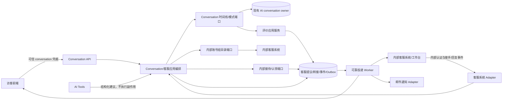

# 013 展会 AI 客服实施计划

**规范：** [spec.md](spec.md) 当前版本
**计划状态：** 方案已据当前用户规则形成；执行受内部客服系统接口及 TAPD 原型确认门禁约束。
**日期：** 2026-11-09（本地接待 owner 已由用户确认）

**当前增量（2026-11-10）：** 用户确认本项目维护四类业务分组及成员关联，用户中心保留账号/租户/组织启用owner；接待配置、助手分类映射及语义预览有独立设置页，人工实时同步采用登录JWT首帧认证WebSocket，统一调试中心聚合六项入口。详见[routing-realtime.md](routing-realtime.md)。此规则覆盖下文历史“外部组/成员主写”和人工SSE实施描述；AI生成仍使用原流式协议。新增路由迁移及真实语义模型、正式身份和WSS部署验证保持显式待办。

**配置与结构收敛（2026-11-10）：** 内部能力随应用运行，Mock管理仅限专用测试Profile；HTTP按接待、跟进和运行管理分工，领域内容策略与外部协议分层，详见[structure-review.md](structure-review.md)和[configuration.md](configuration.md)。本轮Java185、Node17、隔离浏览器26项通过；整个013目标环境及发布验证仍保留缺口。

**上一批补充（2026-11-10）：** 工单最终邮件回复、可靠投递与显式结案、两类业务入口见 [followup-response.md](followup-response.md)。在线/容量、带代次心跳、改派、可信系统可靠任务和指标/告警样例已落地，见 [availability-system-metrics.md](availability-system-metrics.md)。proposeResolution的同轮高置信度候选加真实十分钟idle已通过admin/模型/MySQL验收。定向Java171项、Node17项、隔离业务页面9项、在线改派11项、系统/指标6项通过。外部通知仍关闭；目标环境依赖中断、正式客服/邮件/Kingbase/多节点及正式告警部署保持 [当前任务](tasks.md) 中未验证状态。

**前批增量：** 等待/邮件、调查与人工 SSE 契约见 [survey-waiting-realtime.md](survey-waiting-realtime.md)。MySQL 5.7 开发库已部署 followup/survey runtime 增量，本机测试 profile 开放等待和调查，真实通知发送关闭。真实 admin/模型/MySQL 调查闭环 5 项通过；模拟双身份、真实 Tomcat/JDBC/SSE 接待浏览器 9 项通过。客服跟进列表、原周期通知重试及等待时独立采集邮箱已接通。本项目是完整人工历史 owner，无旧系统兼容要求；知识纠错通知按用户决定移出本期。正式客服身份、真实通知网关、Kingbase 和多节点发布验收仍待完成，整个 013 保持 PARTIAL。

## 1. 交付目标

交付一条可在正式认证、内部客服账号/组系统、AI conversation、真实实时消息和目标数据库中验证的单一访客闭环：

```text
AI 回答
  → 受限 AI Tool 建议人工
  → 服务端保存建议并发送确认卡
  → 用户确认（或用户直接主动申请）
  → 锁住当前 AI generation
  → 内部客服 owner 接收/认领
  → 客服与访客在同一 conversation 实时沟通
  → 人工结束，AI 恢复或转后续跟进
```

另交付一条不与人工状态混用的 AI 评价闭环：

```text
AI 解决结束候选 → 资格检查 → 单次满意度卡
  → 满意并致谢 / 不满意询问是否转人工
  → 用户明确同意后创建带 SURVEY_DISSATISFIED 来源的新 handoff episode
```

## 2. 架构目标



用户已确认：本项目负责接单、接待状态和聊天消息，内部系统仅管理账号、组、成员。具体实现与验收见 [reception.md](reception.md)，不再等待外部 claim/message 接口。

### 模块职责

| 模块                             | 职责                                                                                           | 明确禁止                                               |
| -------------------------------- | ---------------------------------------------------------------------------------------------- | ------------------------------------------------------ |
| Conversation 应用/owner          | conversation 身份、AI turn、用户/AI/人工统一时间线、generation epoch、AI 结束候选、问卷事实    | 让客服模块直接写其 Entity/表；用解除人工表示 AI 已解决 |
| Customer Service domain          | proposal、访客/系统 handoff episode、来源/原因、申请状态、授权决策、外部请求引用、客服事件对账 | 创建客服账号/组/成员事实；信任 LLM 输出的归属和客服 ID |
| Internal Customer System Adapter | 查询账号/组/成员并验证主体和组织启用状态；不写接待状态                                         | 将内部身份数据写入本地作为第二主库                     |
| Frontend/transport               | 访客卡片、等待/消息状态，客服工作台呈现与实时交互                                              | 根据本地按钮点击假设已确认/已接入                      |
| Notification Adapter             | 邮件及等待提醒的可靠投递、回执和失败状态；知识纠错通知不在本期                                 | 只写一条 follow-up 记录就宣称已送达                    |

## 3. 建议接口与领域契约

最终字段在原型与内部系统 API 取得后冻结；先采用以下语义，不围绕旧 `/v1` 形状保留双路。

### 3.1 建议/确认工具

`proposeHandoff` 只返回 `recommend`、`reasonCodes`、置信度、用户可见的简短说明及经服务端核验的证据引用。`conversationId/turnId` 和模型/策略版本由调用环境绑定，Tool 不能回填；Tool 参数不能指定 group/agent/tenant/权限。

`propose_resolution` 只表达“可能已解决”的语义；真正的结束候选、idle 计时、是否能问卷由 Conversation 应用服务裁决。

运行时 Tool 名称为 `proposeResolution`；其模型 schema 只收 `confidence`，不收用户确认、空闲时间、身份或路由。候选先作为 Conversation owner 的不可变事实落库；服务端通过当前 generation 行锁核验时效性。确定性用户结束信号由 Conversation owner 在最终 AI 回复及 Turn 成功持久化后，从本轮成功用户明细与同范围上一条成功 AI 回复判断；精确结束表达可直接分类，“没有”短答必须对应上一条 AI 追问。用户信号与模型候选分开存储，不复制消息正文；新 generation 或人工 owner 后旧信号失效。证据读取/写入失败不得阻塞主回答。两类信号都不等同问卷资格；问卷创建与投递仍需内部客服 owner 历史校验、唯一调查事实及独立事务/Outbox 契约，当前Tool已注册到基础工具集；候选仍不等同调查资格。

客服应用服务向前端发的事件例如 `handoff.proposed`、`handoff.waiting`、`handoff.claimed`、`handoff.cancelled`、`handoff.failed`、`ai.survey.offered`、`ai.survey.answered`。事件须有 `eventId/conversationId/eventSeq/schemaVersion/occurredAt/traceId`。卡片 ID / survey ID 稳定且持久化后再推送。

### 3.2 命令边界

逻辑命令包含：`ApplyHandoff`、`ConfirmProposal`、`DismissProposal`、`ContinueWaiting`、`CancelHandoff`、`ClaimHandoff`（仅内部 owner/授权客服）、`AppendAgentMessage`、`EndHandoff`、`ProposeAiResolution`、`AnswerSurvey`、`ChooseHumanFollowup`。

每个命令具有 `requestId`、目标 conversation 和期望版本；主体/租户/组织从认证或服务端 conversation 取得。重复键返回原结果；同 key 不同 payload 拒绝。跨系统命令以 Outbox 幂等投递；内部系统 webhook/event 有签名、时间窗、防重放和来源验证。

API 统一使用正式命名空间 `/api/customer-service`；旧版本 Controller/DTO 不维持并行兼容，WebSocket 和事件沿用当前协议结构。

## 4. 事务、并发与恢复

- `Apply/Confirm`：短事务锁 conversation generation 和 handoff version，校验状态、身份、路由配置，写 HandoffEpisode、事件、命令幂等回执和 Outbox；在事务边界明确后向内部系统异步/同步提交命令。若要两阶段成功提示，必须等外部请求接受回执，不能只以本地 Outbox 入库就显示“排队成功”。
- 本地 claim：正式组成员以稳定 requestId/expectedVersion 原子接单，generation→episode 行锁与唯一 claim 约束保证一个赢家；状态/回执/Outbox 同事务。
- AI 输出：每次模式变化推进 generation epoch；LLM 响应提交前再次校验 epoch 与当前 speaker mode。取消信号只是优化，不是正确性边界。
- 消息：经 Conversation 时间线单写端口；使用 client message ID 幂等；发送人与有效 handoff claim/授权版本匹配。
- 推送：数据库写成功后由 Outbox 发布，客户端按 `eventSeq` 去重；事件缺失时拉 snapshot + incremental，再续 WS。在线确认卡、claim、survey 事件都可重放或按状态读取恢复。
- 取消：本项目在 generation→episode 锁内只允许原申请者取消 REQUESTED，原子推进 CANCELLED 与恢复 AI；已 CLAIMED/ACTIVE 时拒绝访客取消。旧异步写入口移除。
- 期限：等待流程持久化T+5内部提醒、T+10访客提示和营业结束的UTC期限及日历版本，在当前会话访问时补算，不再全局扫描；无人访问时不主动推进。用户沉默调查及其期限已移除；问卷过期仍按调查生命周期恢复。
- 撤权：内部系统通知或每次敏感操作即时复核；同步通知延迟不允许无界保留旧客服权限。旧连接关闭，当前未接手申请重路由或转待跟进。

## 5. 阶段及退出条件

每个阶段以退出证据为准，不以代码合并或测试数量代替闭环。任务状态见 [tasks.md](tasks.md)。

### 阶段 0：事实与依赖契约

产物：可读 TAPD 两条原型；内部客服系统 API/事件/主体映射/在线/claim/message 能力矩阵；修订后的 SOP 规则决议（等待、邮箱、时间、问卷一次性）；owner 矩阵和信任边界。

退出：内部 owner 对账号、组、成员、可用状态、claim 和消息的每项写入权明确；原型中关键态能映射到本规范；隐私/通知和邮箱冲突有决定。若 TAPD 仍不可读，界面只能按本文逻辑开发，画面验收必须保留 blocker。

### 阶段 1：重立契约与清理旧方向

产物：事件/命令 schema、状态转移表、内部 Adapter 契约测试、AI tool schema、安全威胁分析、数据生命周期决议。删除“零等待直接拒绝”、本地客服组/账号主写和无关 HITL/Jev 前置条件。

退出：契约测试能证明模型没有客服身份/路由写权限；服务端身份来自认证/授权上下文；内部系统不可用时有明确 retryable 状态；不存在两边同时写的事实。

### 阶段 2：Conversation 与 handoff 基础纵切

实现真实 conversation 初始化/绑定、身份和来源解析、generation epoch/提交围栏、proposal 持久化、Outbox 以及访客主动申请/确认/拒绝/取消命令。使用一组本地内部系统合同 stub + 隔离目标数据库先验证完整持久化，不把测试 Fake 作为阶段出口。

退出：同一真实 conversation 能收到 suggestion card；主动申请不二次确认，AI 建议要确认；重放/迟到输出不重复或抢答；正式认证和 owner 权限拒绝有证据。

### 阶段 3：内部客服系统路由与实时接待

实现内部组路由、真实 agent 身份映射、受信 claim 和回调、同一时间线双端消息、客服 WS/SSE 及水位回放、首响与结束。接通工作台必要状态，不实现重复账号/组管理。

退出：一个真实账号在 owner 系统中认领后，访客确认显示真实客服已接入；客服和访客实时互发，重新连接补齐；超时、重复 claim、撤权和迟到事件均正确。

### 阶段 4：工作时间等待和后续跟进

实现T+5内部提醒、T+10访客可继续等待/邮件选择、营业结束收敛、非办公时间ticket/email follow-up。2026-11-11起等待期限改为当前会话查询、操作及实时订阅按需补算，无全局等待扫描，无人访问时不主动通知或关闭申请。已登记通知和reply保留可靠状态、租约及重试。

退出：用可控时钟覆盖边界分钟/时区/工作日；常规在线申请不强制采集邮箱，选择邮件跟进时必须采集，不满意评价同意在线转接后并行采集且不能阻塞转接；邮件 receipt 或最终失败可查；等待用户断线后状态可恢复。

### 阶段 5：AI 结束、满意度和反馈来源

实现 resolution candidate、成功 Turn 后的确定性结束信号、一次性 survey、满意/不满意/过期及明确 opt-in handoff。当前完整历史评估生产者、调查 HTTP/页面、展示回执消费、同事务人工申请已接通；显式解决路径通过真实 admin/模型/MySQL 验收。评估策略 `explicit-resolution-evidence-v4` 保守排除不完整、寒暄、推广和未解决内容；仅用户明确结束或确认无后续问题时评估调查资格，已移除沉默期限和扫描；模型候选Tool已启用；调查后台流程随应用运行，已删除内部细分开关。知识纠错通知延后，由人工依据满意度更新知识库。审计引用已有持久记录，发布指标告警另需部署接入。

退出：每个规范场景有状态事件和端到端证据；人工对话/寒暄不发调查；不满意拒绝不创建 handoff；同意后来源为 `SURVEY_DISSATISFIED_OPT_IN`。

### 阶段 6：目标环境验收与发布

在真实身份、内部客服系统、MySQL/Kingbase（以部署目标为准）、RabbitMQ/通知系统和多节点运行端到端测试；检查权限撤销、锁/幂等、压测、监控、故障演练和回滚。全面替换历史旧草案，不运行双 API/双表写入。禁止对生产真实业务数据直接清理；移除预发布对象前经 owner 确认无数据或已有留存导出。

退出：12 个主要验收关口有真实证据、无未关闭 P0 安全/数据 owner 问题、灰度/关闭新增接入方案经 owner 批准。否则报告 PARTIAL，不宣称完成。

## 6. 风险与验证策略

| 风险                                        | 控制与证明                                                                           |
| ------------------------------------------- | ------------------------------------------------------------------------------------ |
| 内部系统只提供 directory，不支持 claim/消息 | 阶段 0 形成 capability matrix；无唯一写入 owner 不进入分配开发                       |
| AI 工具提示注入/越权                        | Tool schema allowlist、来源绑定、服务端策略校验和不可执行数据测试                    |
| AI 与客服双答                               | generation epoch + 写前 fencing；人工模式下 AI 回复提交必须拒绝                      |
| 外部认领竞态/重复 webhook                   | owner 唯一 claim、稳定幂等键、签名回调和对账 worker                                  |
| 断线后卡片/状态遗漏                         | Outbox + eventSeq + snapshot/incremental + replay test                               |
| 不准确的结束/满意度弹窗                     | conversation owner 确认候选、只问一次、人工/闲聊排除及可控时钟 E2E                   |
| 营业时间边界和用户邮箱                      | 显式 calendar version、DST/time-zone tests、按路径采集、禁止全局阻塞                 |
| 旧实现产生错误双 owner                      | 新规范先冻结；不兼容实现替换旧 Controller/DTO/表 owner；逐项检查是否有实际数据再清退 |

## 7. 测试门槛

- Domain：proposal/episode/survey 状态合法性、重复/过期、原因/来源不可变、取消和结束边界。
- Application/Tool：工具结构校验、模型失败无副作用、用户来源不同结果、generation fencing、可靠 Outbox。
- Adapter contract：账号/组/主体映射、时区/可用能力、claim 唯一性、webhook 签名、错误分类和分页。
- Persistence：真实目标数据库锁/唯一约束/迁移/回滚/竞争；H2 仅做快速测试。
- Browser：真实访客登录、AI 建议卡、主动申请、等待/取消、客服认领、双向文本、断线恢复、结束恢复 AI、AI 调查三结果。
- Security：跨租户/组织/组读取、伪造来源/ID、失效 token、撤权时旧连接、LLM prompt injection 和外部回调重放。
- Operations：T+5/T+10、邮件成功/失败、dead letter 重放、Outbox 对账、告警和故障恢复。

## 8. 旧文档关系

本计划是当前实施顺序。`changes/add-human-handoff-workbench/` 中的 `design.md`、`technical-plan.md`、`tasks.md`、`api-contract.md` 保留为历史研究证据，其标题处标记已废止；冲突规则不可引用为现行实现要求。当前规范唯一权威路径为 `specs/013-human-customer-service/spec.md`、`plan.md`、`tasks.md`。

[handoff-api.md](handoff-api.md) 是已落地访客申请、恢复和取消意图接口的实现契约补充；其中明确的未实现项不能作为阶段出口证据。

[ai-resolution-candidate.md](ai-resolution-candidate.md) 描述阶段 5 的模型候选切片；运行时 Tool 在问卷资格和评价闭环接通前保持禁用。
