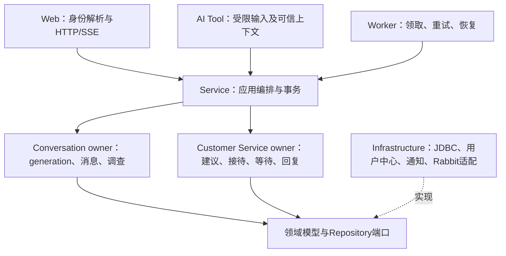

# AI智伴与人工客服结构审查

2026-11-11 复核：实时连接直接复用登录JWT；人工双通道、每秒远程身份核验和上线后才能手动接单三项也已简化，最终行为及验证见[当日简化记录](design-simplification-review-20261111.md)。本文件后文的SSE和逐次用户中心扫描仅为2026-11-10历史实现记录；全部SQL新入口见[数据库整理](database-20261111.md)。

审查日期：2026-11-10。结论：保留同一应用内的分层与业务owner是合理的，原实现存在分阶段开关过多、HTTP职责膨胀、协议代码层级错误和规则混入应用编排的问题，本轮已做定向修正。无需拆成两个后端服务，也无需逐个启用内部流程。

## 2026-11-10 可视化测试配置增量

新增本机测试Controller只做认证/来源、严格DTO和revision校验，调用既有日历及通知诊断领域端口；不直接依赖infrastructure、Entity或Mapper。通知沙箱和企微机器人客户端位于infrastructure，前者仅独立probe事件，后者隔离官方HTTP协议；两者只共用安全提醒模板，不将沙箱受理写回业务任务。Calendar使用完整不可变策略快照，WaitingService在初始化时以同一快照计算两个窗口，避免配置替换期间混合期限。

真实通知发送仍由CustomerServiceNotificationPort承载；supports(kind)与Repository在LIMIT前过滤通道配合，避免仅配企微而邮件占满队列或消耗重试次数。无新表、无多owner写同一事实、无核心事务内远程发送。测试Controller与沙箱均仅customer-service-test注册，普通Profile仅部署Adapter实现业务通知port，不增加第二套生产状态机或外发owner。

已评估并移除“沙箱替代真实Worker端口”的中间方案：本地模拟会把实际业务任务记成SENT，污染可靠投递事实。最终通过独立探针演示模板/失败重试，持久租约/退避/死信另以真实JDBC回归验证。企微不能提供网关级事件键幂等，相关限制在配置契约明确说明，禁止以沙箱幂等冒充真实企微去重。

## 范围和方法

本轮以工作区新增/修改的171个生产Java文件为清单：API 7、common 4、core 14、domain 69、infrastructure 24、service 33、web 20。清单保存在本机`.codex/customer-service-structure-inventory.json`，包含路径、行数和分层依赖检查；不包含密钥或配置值。该数量包含原类的上下文传播和Tool接入修改，不代表新增了171个独立服务。

检查了模块依赖、外部/内部边界及配置注册方式，并沿“用户申请→generation围栏→episode→在线接单→消息/回执/SSE→结束恢复AI”“等待→邮件任务→受理→结案”“模型候选/结束信号→内容评估→调查→明确opt-in”“最终故障→可靠系统任务→人工申请”的关键链路检查方法职责、状态推进、锁序、幂等与副作用。

依赖扫描没有发现domain向service/core/infrastructure/web、infrastructure向service/core/web、service向infrastructure/web的新增直接import。此结论只覆盖静态Java依赖，不等于所有运行行为或目标数据库均已验证。

## 合理的结构

| 边界                            | 判断与保留原因                                                                                                                                |
| ------------------------------- | --------------------------------------------------------------------------------------------------------------------------------------------- |
| Conversation与Customer Service  | 同项目仍有不同数据owner。客服只通过端口使用回复权和消息正文，不直接写AI持久化Entity/Mapper                                                    |
| 用户中心与业务分组              | 按2026-11-10用户确认，用户中心唯一管理账号/租户/组织启用，本项目客服owner管理业务组和成员关联；只保存账号引用，绝不复制账号主表               |
| generation/episode/availability | 围栏、周期状态和组织级容量是不同事实；锁序generation→episode→目标运行行，保证取消/接单/改派及迟到AI隔离                                       |
| 状态机与不可变命令/投影         | REQUESTED/CLAIMED/ACTIVE/RESOLVED/CANCELLED及等待、回复状态有集中规则；record类型多数用于明确可信字段及约束，不建议为减少文件数合成万能DTO    |
| 本地事务                        | 跨owner通过明确端口编排、共享数据源原子提交是当前部署的合理选择；不能拆成独立提交，否则会产生HUMAN/episode半写                                |
| 邮件及系统可靠任务              | 需要持久幂等键、租约/CAS、有限重试、DEAD及人工恢复；同进程并不能替代崩溃恢复能力                                                              |
| WebSocket和持久恢复             | 人工状态及消息使用独立传输Adapter与按seq恢复，共用数据库事实；HTTP保存成功不伪装成对端收到，撤权/改派后继续复核当前权限。AI生成仍用原流式协议 |

## 本轮修正

| 问题                                       | 原影响                                                                            | 调整                                                                                                                                  |
| ------------------------------------------ | --------------------------------------------------------------------------------- | ------------------------------------------------------------------------------------------------------------------------------------- |
| 内部enabled/api-enabled过多                | 页面可访问而接口未注册、后台不推进，测试Profile又覆盖另一组开关，部署组合难以理解 | 删除接待/在线/等待/回复/调查/idle/系统/指标/建议到期的内部开关及对应guard，统一随应用运行                                             |
| 目录fallback与Mock配置混在普通联调Profile  | 用户中心未配置被当作另一种能力模式；目录管理Mock易随普通Profile启用               | 固定UserCenterAccountDirectoryAdapter，删除Unconfigured实现；Mock管理和目录联调Controller只在customer-service-directory-test注册      |
| Reception Controller跨接待、邮件、运行管理 | 依赖过多、职责扩散、字段注入隐藏装配要求                                          | 拆为Reception、Followup、AgentOperations三个Controller；路径保持一致，全部使用构造注入                                                |
| 拆分后重复授权/异常处理风险                | 各入口可能出现不同身份或HTTP错误语义                                              | 共享CustomerServiceRequestAccess、严格Requests、HttpResponses和限定范围ExceptionAdvice；访客同时匹配原申请主体及assistant/bvent       |
| Rabbit配置与Publisher放在service           | 应用层依赖RabbitTemplate及交换机协议                                              | 移至infrastructure，显式声明AMQP依赖；Worker仍只依赖领域发布端口，删除对service配置类的反向引用                                       |
| 调查内容规则混在事务服务                   | 修改内容判断需要理解持久化和跨owner事务                                           | 抽为无IO的AiSurveyContentPolicy；应用层只读取事实并保存结论/编排调查。候选阈值与版本归AiResolutionCandidate统一持有，判断语义保持不变 |
| 外部事件转发关闭仍报Outbox积压             | 本地审计事实被误报为对外投递故障                                                  | 只在可选外部转发开启时统计其dead/over_5m，保留等待/系统/回复自身指标与真实首响审计                                                    |
| 只读Episode Adapter残留写入依赖            | 无用ObjectMapper构造参数及旧写入import误导职责                                    | 删除这些依赖，同步所有调用点                                                                                                          |
| 文档测试仍守废弃旧协议                     | 绿色测试仍要求零排队，与现行等待流程相反                                          | 改为当前规范、owner和实际接口契约，更新配置说明                                                                                       |

内部流程无需Rabbit往返：接单、取消、聊天和调查在本应用及同数据源内完成，外部转发默认关闭，仅供实际存在的外部消费者使用。通知发送默认关闭；接口和Worker内置不等于已经配置真实网关。配置项及默认值见[configuration.md](configuration.md)。

## 后续维护项

以下项目未发现阻断本轮配置和职责调整的正确性问题，建议在对应能力继续扩展时处理，避免本轮扩大成整个客服模块重写：

1. `CustomerServiceSystemHandoffService`同时提供任务登记/人工恢复和调度消费。当前每条处理职责清楚且有真实事务回归，下一次扩展故障来源时宜将调度入口移到专用Worker，服务只编排单个任务。
2. `CustomerServiceHandoffProposalRepositoryImpl`约544行，覆盖同一建议/申请聚合的幂等、状态与事件SQL。owner没有混写，但可进一步提取同owner内的固定行映射和事件写入辅助组件；不能按数据库表拆成多个独立写入owner。
3. 2026-11-11已处理原每秒远程核验：连接首帧及每60秒查询用户中心，逐次快照只查本地成员/认领；已明确账号禁用生效窗口，不声称即时外部撤权。后续如需缩短此窗口，应接入权威撤权事件或版本接口。
4. 对外Outbox和本地审计事件当前共表。关闭转发时事实保留为PENDING，已排除外发积压误报；后续应明确审计归档策略及首次开启转发是否回放历史，不能把未发送事实批量改为已送达。
5. 少数新增JDBC/系统编排类仍有较长单行及通配import，个别record字段说明未展开到逐参数。此次整理了受影响Controller、访问/响应组件、策略、指标、Worker的格式；其余适合按能力局部整理，不做全仓格式化。

## 验证与限制

2026-11-10分组/语义/实时增量：`CustomerServiceRoutingConfigurationService`只编排配置核验和CAS，`CustomerServiceHandoffRoutingService`将事务外分类与事务内路由冻结分开，`CustomerServiceSemanticClassifier`复用统一模型入口并约束结构化输出；业务组及路由由一个Repository owner持有，用户中心账号通过独立防腐服务只读核验。独立RealtimeQuery组合应用端口，WebSocketHandler只负责首帧认证、游标、传输及资源生命周期。没有把模型或WebSocket协议塞进接待状态机。

配置锁与接待成员复核共用组织版本行，避免撤权提交后旧请求仍写入；调整助手映射保留首次申请组和版本，原组继续处理旧单，成员撤销仍立即生效。浏览器迟到问卷回执在异步认证后重验会话代次，避免切会话后写旧回执。新迁移结构、测试及限制见[routing-realtime.md](routing-realtime.md)；本轮新增路由表，不将上一批“无数据库增量”的结论套用到本轮。

生产reactor打包已通过，显式跳过全仓测试编译。定向Java覆盖默认无开关装配、Mock默认不注册、外发默认关闭、访客主体/路由拒绝、HTTP严格字段、在线/容量/改派、系统恢复、指标、等待、调查与邮件可靠任务。前端回归与隔离Tomcat/H2/JDBC/SSE/本机网关浏览器结果见本机`.codex/qa/customer-service-structure-20261110/report.md`。

本轮没有新增数据库结构或执行迁移，没有清表、提交Git或发送真实邮件。旧本机8081测试服务因占用待打包JAR已停止，未在环境不可用时声称新版正式链路可用。真实用户中心/开发MySQL、Kingbase、多节点和真实邮件网关的部署验收不由H2或模拟身份代替；全仓测试既有Tencent properties/DTO缺类限制仍需单独处理。整个013功能的发布状态继续以tasks.md为准。
